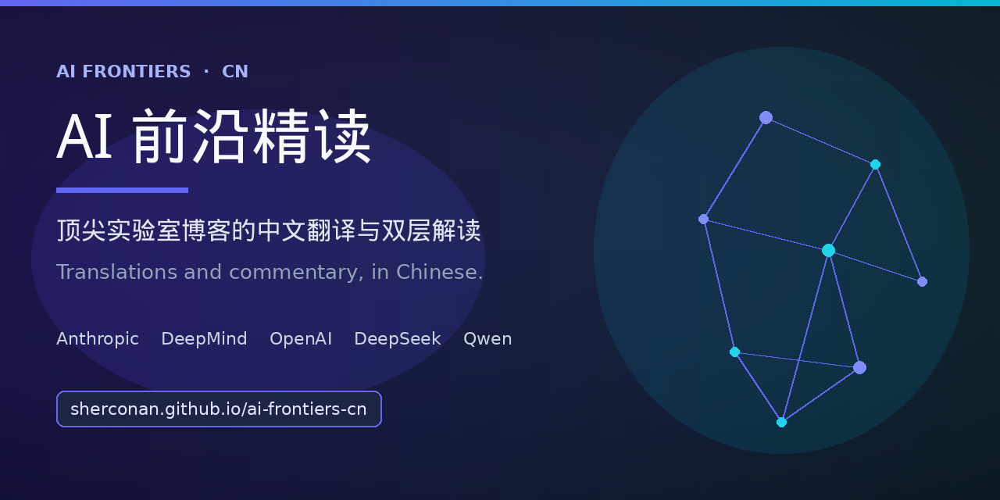

<div align="center">

# AI 前沿精读

**Anthropic、DeepMind、OpenAI 的博客，中文能读完，还带着给从业者的第二层注释。**

Chinese translations and a second layer of notes on blogs from Anthropic, DeepMind, OpenAI, and other frontier labs.

### [在线阅读 → sherconan.github.io/ai-frontiers-cn](https://sherconan.github.io/ai-frontiers-cn/)

打开即读，大约 10 秒。不用克隆，不用安装。

[](https://sherconan.github.io/ai-frontiers-cn/)
[](https://github.com/sherconan/ai-frontiers-cn/stargazers)
[](LICENSE)

</div>

英文博客散落在各家官网。这里把它们译成中文，并在译文之外再写一层解读：先把概念说清楚，再把术语和细节留给从业者。

## 适合谁

| 适合 | 不适合 |
|------|--------|
| 想跟实验室博客，但不想每篇都从英文硬读的人 | 要官方原文或论文 PDF 的人（文内注明出处，原文以官网为准） |
| 做模型、Agent、对齐，需要带术语和出处的中文笔记 | 要 API 教程、微调步骤或零基础课程的人 |
| 可以补一篇翻译，或改一处错误的人 | 要滚动新闻的人（主体是精读；每日精选是从已有文章里挑一篇导读） |

## 10 秒开始读

直接打开站点：**<https://sherconan.github.io/ai-frontiers-cn/>**

可以从这些入口进去：

- [Anthropic](https://sherconan.github.io/ai-frontiers-cn/anthropic/) — 目前篇数最多
- [按主题](https://sherconan.github.io/ai-frontiers-cn/topics/) — Agent、安全与对齐、推理、工程实践、模型发布
- [时间线](https://sherconan.github.io/ai-frontiers-cn/timeline/) — 按时间看进展
- [每日精选](https://sherconan.github.io/ai-frontiers-cn/daily-picks/) — 从已有文章里挑的短导读

页内可以搜索（VitePress 本地搜索）。

要改文章或加翻译，再用文末的本地运行。那不是阅读的必经步骤。

## 覆盖范围

篇数按仓库里的文章文件计（不含各目录的 `index.md`，也不含「目录索引」页）。导航上的数字是手写的，可能和这里不一致。

| 来源 | 篇数 | 代表文章 |
|------|------|----------|
| [Anthropic](https://sherconan.github.io/ai-frontiers-cn/anthropic/) | 61 | 对齐伪装、Building Effective Agents、电路追踪 |
| [OpenAI](https://sherconan.github.io/ai-frontiers-cn/openai/) | 27 | GPT-5.4、o3 / o4-mini、Codex |
| [Google DeepMind](https://sherconan.github.io/ai-frontiers-cn/deepmind/) | 27 | Gemini、AlphaFold 3、AlphaEvolve |
| [研究者与基础论文](https://sherconan.github.io/ai-frontiers-cn/researchers/) | 25 | Transformer、Karpathy、Lilian Weng |
| [Qwen / 通义](https://sherconan.github.io/ai-frontiers-cn/qwen/) | 10 | Qwen3、QwQ |
| [DeepSeek](https://sherconan.github.io/ai-frontiers-cn/deepseek/) | 9 | V3、R1 |
| [Meta AI](https://sherconan.github.io/ai-frontiers-cn/meta-ai/) | 9 | Llama 4、Llama 3.1 405B |
| [Kimi / 月之暗面](https://sherconan.github.io/ai-frontiers-cn/kimi/) | 8 | K2、K2.5 |
| [Mistral](https://sherconan.github.io/ai-frontiers-cn/mistral/) | 7 | Mistral Large 2 |
| 其他 | 11 | xAI Grok、NVIDIA Nemotron、Hugging Face 排行榜、Microsoft Phi-4、MiniMax / 智谱 / 百川 |

上表合计 194 篇。另外还有 [每日精选](https://sherconan.github.io/ai-frontiers-cn/daily-picks/) 5 篇，以及 [2026 Q1 大模型横评](https://sherconan.github.io/ai-frontiers-cn/special/2026-q1-llm-landscape)。

## 一篇文章里有什么

仓库里的约定是两层：入门解读把概念说清楚，技术解读保留术语和细节。标题并不完全统一。常见小节是：

- 一句话摘要
- 中文译文（有的篇目标成「核心内容」或「完整核心内容翻译」；有的分成「通俗解读 / 技术深入」）
- 技术要点
- 深度解读
- 延伸思考
- 原文链接（标题、作者、日期、URL）

## 参与贡献

欢迎新翻译和勘误，直接提 Pull Request。

新文章请：

1. 在对应目录加一篇 Markdown，例如 `docs/anthropic/your-slug.md`。还没有目录的来源，可以新建 `docs/<来源>/`。
2. 在该目录的 `index.md` 加一行链接。
3. 在 `docs/.vitepress/config.ts` 的侧栏加上条目。导航是手写的，新文件不会自动出现在菜单里。
4. 按下方步骤本地看一眼，再提交。

请确保：

1. 翻译准确，保留原文术语
2. 包含入门和技术两层解读
3. 注明原文出处和日期

## 本地运行

只有要改内容时才需要这一步。

```bash
git clone https://github.com/sherconan/ai-frontiers-cn.git
cd ai-frontiers-cn
npm install
npm run docs:dev
```

开发服务器带有站点 `base`，请打开 <http://localhost:5173/ai-frontiers-cn/>。

站点用 VitePress 生成，由 GitHub Actions 部署到 GitHub Pages。

## 分享图

1280×640 封面：[`docs/public/og-cover.png`](docs/public/og-cover.png)。站点分享时会用这张图。

<p align="center">
  
</p>

## License

[MIT](LICENSE)
